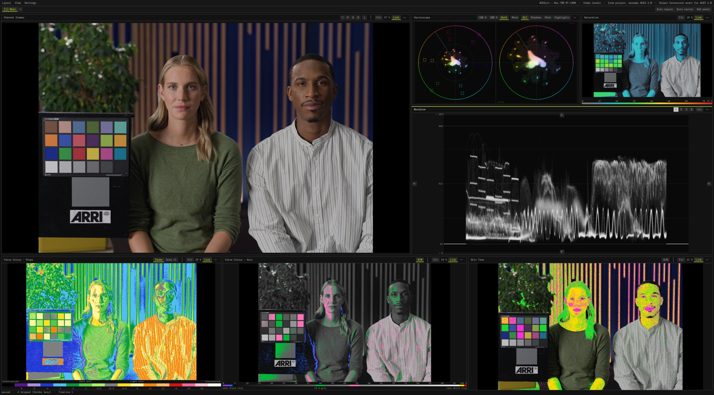

# ScopeCreep

Real-time, professional-grade video scopes for DaVinci Resolve, on their own screen.

ScopeCreep is free to use, and it is built and maintained by one person. It took a lot of evenings, a lot of testing inside Resolve and a lot of coffee to get here. If it saves you time on a grade, or you would like to see it keep improving, a small donation genuinely helps me keep working on it. Never expected, always appreciated.

<a href="https://www.buymeacoffee.com/tomzandtvalentine"></a>

ScopeCreep takes the picture Resolve is playing (the **Feed**) and shows it next to **Scopes** (luma waveform with Colorise, vectorscopes) and **Picture Views** (clean picture with channel chips and a Loupe, false colour, skin tone, saturation) in a separate app. The goals:

- **Accurate.** Every pixel is measured at full resolution in 32-bit float, in the project's actual colour space. Anything that isn't exact is labelled as approximated.
- **Invisible.** Turning ScopeCreep on must not change Resolve's playback frame rate.
- **Cross-platform.** Windows, Linux and macOS, on Resolve 21.x.
- **Quiet.** A tool, not a sales pitch: no clutter, and sensible defaults read from the Resolve project.



## Status

Pre-alpha.

## Download

Installers are on the [Releases page](https://github.com/TomZandt/ScopeCreep/releases). Each Release lists the platforms it includes (Linux for now) and has a `SHA256SUMS` file to check your download. While the version starts with 0 it is a pre-release. Unpack the Installer and read its `INSTALL.txt`.

| Stage | What | State |
|---|---|---|
| 0 | Colour and performance checks against Resolve (throwaway prototypes) | Done ([report](docs/stage0-report.md)) |
| 1 | Feed plus clean picture plus luma waveform (Linux, NVIDIA) | Released in v0.1.0 |
| 2 | Every display in its own Panel: 14 Panels (waveforms, vectorscope, CIE plot, false colour, skin tone and more) | Released in v0.2.0 |
| 3 | A colourist's Window: the picture as the hero, arranged and saved layouts, title bars and one Colour Setup line, a style system with Panel toolbars and sliders, stronger Skin Tone and heatmap, following the scrub | Partly released in v0.3.1 (menu bar, user-assignable hotkeys, Z for Fit, Ctrl+F to fill the Window, on top of v0.3.0's Panel toolbars and chips, sliders for every amount setting, horizontal legends, waveform Scale units, Vectorscope Tonal range, zoom, pan and Link); in progress. Specs [#94](https://github.com/TomZandt/ScopeCreep/issues/94), [#113](https://github.com/TomZandt/ScopeCreep/issues/113), [#83](https://github.com/TomZandt/ScopeCreep/issues/83), [#106](https://github.com/TomZandt/ScopeCreep/issues/106); backlog [#119](https://github.com/TomZandt/ScopeCreep/issues/119); checks at Resolve [#120](https://github.com/TomZandt/ScopeCreep/issues/120) |
| 4 | A tiling Window: pages, Panels placed where you want them (add, dock, tabs, copies of a display), Auto layout and Auto resize, popover amounts with value boxes, Gamut Warning, Neutrals and Chromaticity back | Released in v0.4.0 (spec #196) |
| Downloads | Releases built by CI with an Installer per platform, an Update check at start-up, Windows (NVIDIA) and macOS (Apple Silicon) | Specs [#233](https://github.com/TomZandt/ScopeCreep/issues/233), [#234](https://github.com/TomZandt/ScopeCreep/issues/234), [#235](https://github.com/TomZandt/ScopeCreep/issues/235), [#236](https://github.com/TomZandt/ScopeCreep/issues/236), in that order |
| Later | Parade, histogram, HDR, Setup Checklist, Capture, code signing | Decided, parked |

## Development (Linux, NVIDIA)

| Part | Where | What |
|---|---|---|
| Feed protocol | `feed/PROTOCOL.md`, `feed/include/scopecreep_feed.h`, `feed/` crate | The shared-memory ring between Sender and app: spec, C header (Sender), Rust reader and synthetic writer (app, tests) |
| Sender | `sender/` | C++ OFX plugin, Resolve's CUDA render path, async pinned copy into the Feed |
| App | `app/` | Rust + wgpu: one window of Pages, each a layout of Panels, by default 7 (Scopes and Picture Views: the Channel Viewer as the hero, one Vectorscope Panel showing 100 % and 200 % side by side; every display and its former name is in the [Displays table](GLOSSARY.md#displays)), all showing the latest Feed frame (GPU, every pixel, full resolution). Gamut Warning, Neutrals and Chromaticity are offered by Add panel but not in the default layout (#222); the Black and white Panel, the Colour Waveform and the Channel view are built and tested but not in the Window (#118, #145, #162) |

```sh
cargo test                       # Feed protocol (Rust and C against each other) and the app, driven at the Feed seam (waveform tests need a GPU)
cargo run -p scopecreep          # the app (reads /dev/shm/scopecreep-feed, or $SCOPECREEP_FEED); right-click a Panel for its settings: lists of choices (the luma waveform's luma weights, for one) and sliders (trace brightness, soft spread, graticule brightness, tolerances, thresholds, the heatmap scale); --no-scripting to never read the project by Resolve scripting
cargo run -p scopecreep-feed --bin feed-synth   # a moving test card into the Feed, no Resolve needed

make -C sender                   # build the Sender (needs /opt/cuda and Resolve's OpenFX headers)
make -C sender test              # drive the built Sender with a fake CUDA host (needs the GPU, not Resolve)
make -C sender install           # developer install into /usr/OFX/Plugins, then restart Resolve
```

In Resolve, put **ScopeCreep** (Effects > OpenFX > ScopeCreep, the Sender) on its own last timeline node, with no grade on that node. GPU processing must be CUDA.

### Running the app from the app launcher

The launcher entry (`~/.local/share/applications/scopecreep.desktop`) runs a copy of the app installed outside the repo, so cleaning build outputs (`cargo clean`) never breaks it:

```sh
cargo build --release -p scopecreep && install -Dm755 target/release/scopecreep ~/.local/bin/scopecreep
```

The installed copy doesn't update itself: run the line above again after changing the app. The app shows a picture only while a Sender is playing in Resolve.

### Test projects

The `scopecreep-test-*` projects (in Resolve's `scopecreep` project folder) were built with the Stage 0 probe on their timeline node, and that plugin is no longer loaded, so each one needs ScopeCreep put there once (a script cannot add or swap an OpenFX plugin on a node). Install the Sender with `make -C sender install`, restart Resolve, then in each project open the Color page, select the timeline node labelled `sender`, remove the probe from its OpenFX tab and add ScopeCreep from Effects > OpenFX. `python3 harness/harness.py clone-sender --verify-only` then checks every project has the Sender on that node.

## How it works

```
DaVinci Resolve                                 scopecreep app (Rust + wgpu)
┌──────────────────────────────┐               ┌──────────────────────────────┐
│ timeline node tree           │   the Feed    │ Output Conversion (if needed)│
│  … grades → [Sender (OFX)] ──┼──────────────►│   ├─► Picture View           │
│            32-bit float      │ shared memory │   └─► Scopes (GPU compute)   │
└──────────────────────────────┘               └──────────────────────────────┘
```

- **Sender:** a small C++ OFX plugin placed on the last timeline node. It hands each rendered frame to ScopeCreep without ever making Resolve wait.
- **App:** reads the Feed, converts it from the Timeline Colour Space to the Output Colour Space when required, and draws the Scopes and Picture Views on the GPU.
- **Colour Setup:** read from the project by Resolve's scripting API (Studio, external scripting set to Local) while playback is stopped, with a manual override on the Sender node (ADR 0005, ADR 0006).

## Documentation

- [GLOSSARY.md](GLOSSARY.md): the project's vocabulary. Use these terms in code, issues and docs.
- [docs/adr/](docs/adr/): architecture decisions and why they were made. The displays were renamed later (Clean picture is now Channel Viewer, and so on): older ADRs, findings and the changelog keep the names of their day, and the [Displays table](GLOSSARY.md#displays) in the glossary maps each former name to the new one.
  - [0001](docs/adr/0001-ofx-sender-with-output-conversion.md): the Sender is the primary Feed Source; ScopeCreep does the Output Conversion
  - [0002](docs/adr/0002-cpp-sender-rust-app.md): C++ Sender, Rust + wgpu app
  - [0003](docs/adr/0003-resolve-never-waits.md): Resolve never waits for ScopeCreep
  - [0004](docs/adr/0004-luma-follows-measured-space.md): luma weights follow the Measured Space
  - [0005](docs/adr/0005-colour-setup-from-scripting-api.md): the Colour Setup comes from Resolve's scripting API and a manual override
  - [0006](docs/adr/0006-colour-setup-helper.md): the app reads the Colour Setup through a helper it owns; only the manual override travels in the Feed
  - [0007](docs/adr/0007-labels-claim-only-what-is-proven.md): labels claim "exact" only for what has been proven
  - [0008](docs/adr/0008-manual-colour-setup-does-not-mirror-the-project.md): the Sender's manual Colour Setup controls don't mirror the project
  - [0009](docs/adr/0009-exposure-in-scene-light-clipping-on-output.md): exposure in stops is measured in scene light; clipping and legal checks on the Output picture
  - [0010](docs/adr/0010-false-colour-schemes-are-not-licensed-or-named.md): third-party false colour schemes are modelled, not licensed, and never claimed
  - [0011](docs/adr/0011-every-display-has-its-own-panel.md): every display has its own Panel, always visible, in a fixed grid
  - [0012](docs/adr/0012-panel-grid-shape-follows-display-count.md): the Panel grid's shape follows the number of displays, not the window, and Panels fill their cells (updated #96: a layout of cells and spans)
  - [0013](docs/adr/0013-panel-settings-are-kept-by-display-name-and-offered-as-choices.md): Panel settings are lists of choices or amounts (sliders), kept by display name in a text file, in a menu the app draws itself
  - [0014](docs/adr/0014-gamut-warning-judges-every-channel-in-fractions-of-the-levels-range.md): the gamut/legal warning judges every channel, in fractions of the Levels' range
  - [0015](docs/adr/0015-display-state-is-remembered-beside-the-settings.md): what a display moves by hand (the Loupe) is remembered beside the settings, not as a setting
  - [0016](docs/adr/0016-arri-style-band-edges-and-out-of-gamut-luma.md): ARRI-style bands take Luma as the picture has it, include lower edges, and have open ends
  - [0017](docs/adr/0017-waveform-brightness-is-relative-density-with-a-phosphor-response.md): the waveform's brightness is density relative to the Panel and frame, with a phosphor response and a separate soft spread pass
  - [0018](docs/adr/0018-vectorscope-skin-tone-angle-is-assumed-and-shared.md): the vectorscope skin-tone line's angle sits in one shared constant (first assumed at 134.5°, now measured from Resolve at 123°)
  - [0019](docs/adr/0019-stops-false-colour-decodes-the-timeline-frame-as-it-draws.md): Stops False Colour takes the Timeline Colour Space frame and decodes it as it draws
  - [0020](docs/adr/0020-cie-plot-reads-the-output-encoding-as-light.md): the CIE plot reads the Output encoding as light, decoded by the Output Colour Space's name
  - [0021](docs/adr/0021-skin-tone-tolerance-is-choices-scaled-from-one-width.md): the Skin Tone Panel's tolerance is one width that scales the bands (now a slider), and its tints fade through each other
  - [0022](docs/adr/0022-colour-waveform-tint-is-the-average-colour-at-the-luma-waveforms-positions.md): the Colour Waveform is the luma waveform's counts tinted by the average colour of the pixels counted at each spot
  - [0023](docs/adr/0023-heatmap-saturation-is-a-share-of-the-vectorscope-ring.md): the saturation heatmap's 100 % is the vectorscope's ring (Cb/Cr 0.6 since the ring moved), not each colour's own bar
  - [0024](docs/adr/0024-the-last-sender-in-the-frame-drives-the-feed.md): the last Sender in the frame drives the Feed, and more than one active Sender is a warning
  - [0025](docs/adr/0025-skin-tone-panel-paints-solid-colours-on-the-natural-picture.md): the Skin Tone Panel paints solid flat colours on the picture's own colours (replaces ADR 0021's tints)
  - [0026](docs/adr/0026-style-tokens-by-role-and-the-chrome-check.md): chrome draws only through style tokens named by role; measurement colours are data, exempt from the check
  - [0027](docs/adr/0027-components-are-pure-drawings-of-rectangles-and-text.md): style components are pure descriptions that draw as rectangles and text; legends are horizontal only
  - [0028](docs/adr/0028-every-picture-view-draws-through-one-picture-stage.md): every Picture View draws through one Picture stage (placement, flip, binding, legend strip); a view supplies its colour rule, values and legend
  - [0029](docs/adr/0029-mattes-are-found-by-the-picture-stage-on-the-gpu.md): black mattes around the picture are found once per frame by the Picture stage on the GPU and stay black on every Picture View
  - [0030](docs/adr/0030-named-layouts-are-nine-slots-of-the-grid-text.md): named layouts are nine slots holding the grid's own saved text, recalled through the same checks
  - [0031](docs/adr/0031-the-gate-follows-a-drag-and-judges-fills-per-render.md): the gate follows a drag, and judges a cache fill by the time per render
  - [0032](docs/adr/0032-colorise-is-one-chip-on-the-luma-waveform.md): Colorise is one chip on the luma waveform, and the Colour Waveform leaves the Window
  - [0033](docs/adr/0033-waveform-scale-units-rename-positions-only.md): Waveform scale units rename positions; nits are for PQ and HLG and say what they assume
  - [0034](docs/adr/0034-the-clean-picture-carries-the-channel-and-the-loupe.md): The clean picture carries the channel and the Loupe, and the Channel view leaves the Window
  - [0035](docs/adr/0035-whole-panel-zoom-of-source-pixels.md): Whole-Panel zoom of source pixels, from Fit to 800 %: free below 100 %, whole steps above, display state never saved
  - [0036](docs/adr/0036-commands-and-hotkeys-in-one-table.md): Every app command is in one table, and the user's hotkeys are kept as changes from its defaults
  - [0037](docs/adr/0037-aces-conversion-pays-gpu-time-for-exactness.md): The ACES 2.0 conversion pays about 1.4 ms of GPU time to stay inside the exact tolerance
  - [0038](docs/adr/0038-the-window-is-a-tree-of-tab-groups.md): The Window is a tree of tab groups: Panels can be added, moved, tabbed and closed
  - [0039](docs/adr/0039-a-panel-is-an-instance-of-a-display.md): A Panel is an instance of a display, so a display can be on the Window more than once
  - [0040](docs/adr/0040-view-controls-live-in-a-view-strip.md): View controls live in a view strip on the menu bar, and title bars are three fixed zones (the strip superseded by 0042)
  - [0041](docs/adr/0041-pages-are-the-layouts-and-auto-layout-is-a-button.md): Pages are the layouts, and Auto layout and Auto resize are one-shot buttons per page
  - [0042](docs/adr/0042-free-to-use-and-modify-commercial-licence-to-sell-or-bundle.md): ScopeCreep is free to use and modify; selling, sharing or bundling needs a commercial licence
  - [0046](docs/adr/0046-icons-are-a-bundled-lucide-font-subset-drawn-through-one-icon-enum.md): icons are a bundled Lucide font subset (ISC, with Feather MIT) drawn through one `Icon` enum
  - [0045](docs/adr/0045-the-interface-uses-the-brand-fonts-only-dm-mono-and-anton.md): the interface uses the brand fonts only: DM Mono for all text and numbers, Anton for the wordmark (OFL), all bundled
  - [0044](docs/adr/0044-the-brand-accent-and-the-hairline-look.md): The brand accent is lime (a user option in Settings > Appearance) and the chrome is Hairline: grey, the accent only as thin lines and text; the view block is on picture Panels only, chips overflow as "+N", a Panel is at least 255 wide and the Window at least 1420 × 833
  - [0042](docs/adr/0042-view-controls-return-to-every-panel-title-bar.md): View controls return to every Panel's title bar as a block, the Colour Setup line sits in the menu bar row, and a page tab has a right-click menu
  - [0043](docs/adr/0043-the-feed-keeps-its-bytes-and-takes-each-platforms-shared-memory-name.md): The Feed keeps its bytes and takes each platform's shared-memory name (Linux /dev/shm, macOS shm_open, Windows named mapping)
- [docs/findings/](docs/findings/): what testing showed, one file per ticket.
- [docs/research/](docs/research/): what public sources say, with dates and links.

## Licence

Free to use, including for paid work, under the [ScopeCreep Licence](LICENSE.md): use it on client work, install it across your company and change it for your own use. Selling it, sharing copies outside your company or bundling it with something else needs a commercial licence. [LICENSING.md](LICENSING.md) explains it with examples. If ScopeCreep earns its place in your workflow, please consider [supporting its development on Buy Me a Coffee](https://www.buymeacoffee.com/tomzandtvalentine): it is what lets one person keep building it.

The fonts and icons the app bundles (DM Mono, Anton, Lucide) keep their own licences: see [THIRD-PARTY.md](THIRD-PARTY.md).
